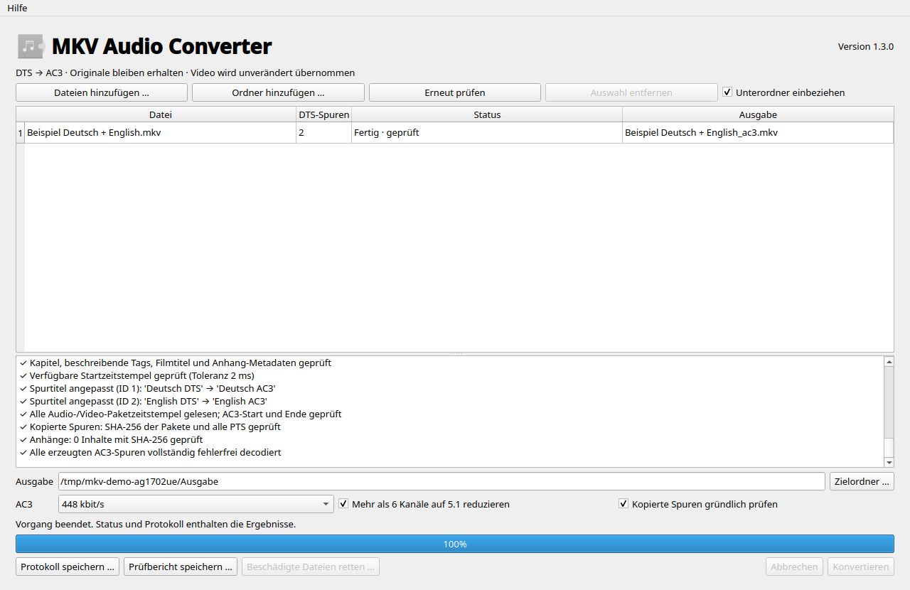

# MKV Audio Converter

Version **1.1.0** · Optionaler Rettungsmodus für beschädigte MKVs mit
Verlustbericht und ausdrücklicher Freigabe. Bedienung und Grenzen:
[RETTUNGSMODUS.md](RETTUNGSMODUS.md). Die Fehleranalyse von 1.0.1 bleibt unter
[FEHLERANALYSE.md](FEHLERANALYSE.md) erhalten.

Eine native PySide6-Anwendung für Fedora KDE: MKV-Dateien oder ganze Ordner
auswählen, alle DTS-Tonspuren nach AC3 umwandeln und die fertigen Dateien separat
speichern. **Originaldateien werden nicht verändert.**



## Schnellstart auf Fedora KDE

1. ZIP oder TAR.GZ entpacken und im entpackten Ordner ein Terminal öffnen.
2. Falls die Programme noch fehlen, die Fedora-Pakete installieren:

   ```bash
   sudo dnf install python3 python3-pyside6 mkvtoolnix ffmpeg-free
   ```

   Eine vorhandene, funktionierende FFmpeg-Installation kann weiterverwendet
   werden. `ffmpeg` und `ffprobe` müssen im Suchpfad liegen. Die Anwendung prüft
   den DTS-Decoder `dca` und den AC3-Encoder `ac3`, da der Codec-Umfang von
   FFmpeg-Paketen unterschiedlich sein kann. Ein fehlender Video-Encoder ist
   für die Konvertierung unerheblich.

3. Start prüfen und Anwendung öffnen:

   ```bash
   bash start.sh --check
   bash start.sh
   ```

   Die mitgelieferten Startskripte sind ausführbar. Falls das Entpackprogramm
   diese Eigenschaft nicht übernimmt:

   ```bash
   chmod +x start.sh install-desktop.sh
   ./start.sh
   ```

4. Optional einen Eintrag im KDE-Anwendungsmenü anlegen:

   ```bash
   bash install-desktop.sh
   ```

   Dafür sind keine Administratorrechte nötig. Der Projektordner muss danach
   an seinem Ort bleiben. Entfernen des Menüeintrags:
   `~/.local/share/applications/mkv-audio-converter.desktop` löschen
   (bei gesetztem `XDG_DATA_HOME` entsprechend dort).

Die Paketnamen sind in den offiziellen Fedora-Verzeichnissen dokumentiert:
[PySide6](https://packages.fedoraproject.org/pkgs/python-pyside6/python3-pyside6/),
[MKVToolNix](https://packages.fedoraproject.org/pkgs/mkvtoolnix/mkvtoolnix/),
[FFmpeg](https://packages.fedoraproject.org/pkgs/ffmpeg/ffmpeg-free/).
Die Installation wird vom Startskript nicht automatisch ausgeführt.

## Alternative mit eigener Python-Umgebung

Benötigt Python ≥ 3.10, PySide6 ≥ 6.7, FFmpeg mit DTS-Decoder und AC3-Encoder,
`ffprobe`, `mkvmerge`, `mkvextract` und `mkvpropedit`. Aktuelle Fedora-Pakete
werden empfohlen. Die Python-Abhängigkeit steht in `requirements.txt`.

```bash
python3 -m venv .venv
.venv/bin/python -m pip install -r requirements.txt
bash start.sh --check
bash start.sh
```

`start.sh` verwendet eine vorhandene `.venv` bevorzugt. Alternativ lässt sich
das Projekt mit `python -m pip install .` installieren; der Befehl
`mkv-audio-converter` startet dann die Anwendung. FFmpeg und MKVToolNix bleiben
externe Programme und sind nicht im Archiv enthalten.

## Bedienung

- **Dateien hinzufügen**: mehrere MKV-Dateien gemeinsam auswählen.
- **Ordner hinzufügen**: optional mit Unterordnern einlesen. Drag-and-drop von
  lokalen Dateien und Ordnern funktioniert ebenfalls.
- Die Tabelle zeigt die Zahl der DTS-Spuren und den Status. Die Tooltips
  enthalten vollständige Pfade und Details zu den Tonspuren. DTS-HD wird über
  die Matroska-Codec-ID `A_DTS` ebenfalls erkannt.
- **Zielordner** leer lassen, um neben jeder Quelldatei zu speichern, oder einen
  gemeinsamen Zielordner wählen. Die Eingabe wird beim nächsten Start übernommen.
- Standard: **AC3, 448 kbit/s, 48 kHz**. Alternativ 384 oder 640 kbit/s.
  640 kbit/s vor Verwendung am eigenen TV testen.
- AC3 unterstützt höchstens 5.1. Spuren mit mehr als sechs Kanälen werden bei
  aktivierter Option auf 5.1 heruntergemischt. Ohne diese Option erhält die
  betreffende Datei einen Fehlerstatus. Kleinere Kanalzahlen bleiben erhalten.
- **Konvertieren** startet die Warteschlange. Sie wird nacheinander abgearbeitet,
  damit große Videodateien den Datenträger nicht durch parallele Remux-Vorgänge
  überlasten. Dateien ohne DTS werden übersprungen.
- **Abbrechen** beendet die aktuellen Werkzeuge und entfernt die unvollständige
  Ausgabe. Bereits fertiggestellte Dateien bleiben erhalten. Beim Schließen
  während eines Auftrags wird zuerst abgebrochen; anschließend kann das Fenster
  geschlossen werden.
- Das Protokoll zeigt die ausgeführten Befehle und Meldungen. Die letzten 4.000
  Zeilen lassen sich speichern; der JSON-Prüfbericht enthält Ergebnisse,
  Fehler, Werkzeugversionen, Optionen und die ausgeführten Prüfungen je Datei.
- Ein Doppelklick auf eine fertige Zeile öffnet ihren Ausgabeordner.
- **Erneut prüfen** liest die Quellen erneut ein und ermöglicht einen weiteren
  Durchlauf, etwa mit einer anderen Bitrate. Fertige Dateien werden innerhalb
  derselben Warteschlange sonst nicht erneut verarbeitet.

Aus `Film.mkv` wird `Film_ac3.mkv`. Existiert der Name bereits, folgen
`Film_ac3_2.mkv`, `Film_ac3_3.mkv` usw. Das gilt auch bei gleichen Quelldateinamen
aus unterschiedlichen Ordnern. Vorhandene Dateien werden niemals ersetzt.

## Was intern passiert

1. `mkvmerge -J` liest die Matroska-Spuren ein. Es werden echte MKVToolNix-IDs
   verwendet, keine angenommenen FFmpeg-Streamnummern.
2. Alle DTS-Spuren werden mit einem einzigen MKVToolNix-Durchlauf gemeinsam in
   einer temporären MKA bereitgestellt. Ihre Reihenfolge wird ausdrücklich
   festgelegt. Die große Quelldatei wird dadurch für diesen Schritt einmal
   gelesen. Video wird dabei nicht übernommen.
3. FFmpeg decodiert jede ausgewählte Audiospur genau einmal und erzeugt je eine AC3-MKA.
   `-copyts` erhält den Zeitbezug; es gibt kein `-start_at_zero`. Die MKA enthält
   auch die von FFmpeg gesetzte AC3-Encoderverzögerung (`CodecDelay`).
   `aresample=async=1` gleicht Tonlücken anhand der Zeitstempel mit Stille aus,
   statt nach einer Lücke dauerhaft asynchron zu werden.
4. `mkvmerge` übernimmt alle übrigen Spuren direkt aus dem Original. Ein
   explizites `--track-order` setzt jede neue AC3-Spur an die Position ihrer
   DTS-Vorgängerspur. **FFmpeg schreibt niemals das Video. Kein Video-Reencoding.**
5. `mkvpropedit` stellt auf der temporären Ausgabe ursprüngliche Track-UIDs,
   Sprachen, Titel und Flags wieder her. Kapitel und Tags werden separat als
   XML übernommen, damit UID-Verweise auch bei automatischer UID-Neuvergabe
   durch MKVToolNix korrekt bleiben. Kapitel-Spurnummern werden bei Bedarf
   auf die entsprechende Ausgabespur abgebildet.
6. Erst nach der Ergebnisprüfung wird die vollständige Datei unter ihrem
   endgültigen Namen sichtbar.

Erhalten bleiben Spurreihenfolge, Video, nicht konvertierte Audiospuren,
Untertitel, Anhänge, Kapitel, Filmtitel, beschreibende Tags, Track-UIDs,
ISO- und IETF-Sprachen, Spurtitel sowie Default-, Forced- und Enabled-Flags.
Vorhandene Commentary-, Original-, Hearing-impaired-, Visual-impaired- und
Text-description-Flags werden ebenfalls übernommen.
Ein Titel wie „Deutsch DTS“ bleibt bewusst unverändert; die Codec-ID ist
anschließend AC3. Veraltete technische DTS-Tags wie BPS/DURATION/ENCODER und
Track-Statistiken der ersetzten Spuren werden entfernt. MKVToolNix darf
ergänzende, aus vorhandenen Sprachangaben abgeleitete IETF-Felder in Kapitel-
und Tag-XML hinzufügen. Containerdatum, Muxerkennung und Segment-UID können sich
durch das Remuxen ändern.

Die relevanten Verhaltensweisen sind in der offiziellen Dokumentation erklärt:
[MKVToolNix: Track-Auswahl, Reihenfolge und Flags](https://mkvtoolnix.download/doc/mkvmerge.html),
[mkvextract](https://mkvtoolnix.download/doc/mkvextract.html),
[FFmpeg: Zeitstempel](https://ffmpeg.org/ffmpeg.html),
[FFmpeg: Audio-Resampling](https://ffmpeg.org/ffmpeg-filters.html#aresample).

## Ergebnisprüfung und Grenzen

Die Prüfung ist obligatorisch und umfasst:

- Spurenanzahl, Reihenfolge, erwartete Codecs, 48-kHz-AC3-Kanalzahlen, UIDs,
  Sprachen, Titel und Flags.
- Kapitel- und Tag-XML sowie Anhang-Metadaten.
- Vollständiges Lesen der Paketzeitstempel beider Dateien, damit auch sehr spät
  beginnende Tonspuren geprüft werden. AC3-Anfang: höchstens 3 ms Abweichung;
  AC3-Ende: höchstens 80 ms wegen Framegröße/Endpadding. Bei verfügbaren
  MKVToolNix-Anfangswerten gilt zusätzlich eine Toleranz von 2 ms.
- Vollständiges Decodieren jeder neu erzeugten AC3-Spur mit Fehlerabbruch.
- Standardmäßig SHA-256-Vergleich der Pakete aller kopierten Spuren sowie
  Vergleich ihrer PTS mit höchstens 2 ms Rundungstoleranz. Zeitstempelreferenzen
  liegen auf der Platte; auch lange Filme benötigen dafür keinen großen RAM.
  Die Inhalte der Anhänge werden ebenfalls mit SHA-256 verglichen.

„Kopierte Spuren gründlich prüfen“ kann abgeschaltet werden. Die übrigen
Prüfungen einschließlich Audio-Decodierung und Start-/Endvergleich bleiben
aktiv. Die Zusatzprüfung benötigt zusätzliche Lesezeit. Ein Fortschrittsbalken
gewichtet Vorbereitung/Audio, Remux und Prüfung; er ist keine genaue Restzeit.
Innerhalb eines Durchlaufs steigt er ausschließlich oder bleibt stehen. Im
Protokoll stehen Startzeit und Laufzeit jedes Werkzeugaufrufs. MKVToolNix-
Warnungen werden sofort als Text angezeigt, auch wenn daneben Fortschritt
gemeldet wird.

AC3 ist eine verlustbehaftete Umwandlung; DTS-HD-/Objektinformationen werden
nicht erhalten. Exotische Kanalanordnungen, beschädigte Zeitstempel oder vom
installierten FFmpeg nicht unterstützte DTS-Varianten können zu einem
Fehlerstatus führen. Dann entsteht keine fertige Ausgabe. Tonlücken können
Stille erzeugen; die Anwendung repariert keine bereits falsch synchronisierte
Quelle. Ein erfolgreicher Container-/Datencheck ersetzt keinen Wiedergabetest
auf dem konkreten Fernseher.

Im normalen Konvertierungsmodus wird bei einer MKVToolNix-Warnung über eine beschädigte EBML-Struktur bzw. eine
Wiederherstellungssuche (`Resyncing`) der Auftrag sofort abgebrochen. Auch echte
FFmpeg-Decodierfehler brechen die Audio-Konvertierung ab (`-xerror`). Dadurch
entsteht aus einer defekten Quelle keine vermeintlich erfolgreich geprüfte
Datei mit übersprungenen Abschnitten. Eine solche Quelle separat reparieren
oder durch eine intakte Kopie ersetzen und anschließend erneut verarbeiten.

Die Anwendung ist für einzelne, normale MKV-Filmdateien ausgelegt. Bei extern
verknüpften Segmenten/Ordered-Chapter-Sammlungen können Verweise auf andere
Dateien außerhalb dieses Auftrags liegen; solche Sammlungen separat verwalten.

## Temporäre Dateien und Speicherplatz

Jede Quelle erhält einen privaten, automatisch entfernten Arbeitsordner im
Zielordner. So liegen temporäre und endgültige Ausgabe auf demselben Dateisystem.
Vor dem Start wird der freie Platz grob auf Originalgröße plus zweimal
geschätzte AC3-Größe und 256 MiB Reserve geprüft. Fehler wie ein volles Laufwerk
werden abgefangen. Die Quelle wird vor und nach dem Auftrag auf Änderungen
von Größe, Zeitstempel und Dateiidentität geprüft.

Die endgültige Veröffentlichung nutzt einen exklusiven Hardlink und kann
dadurch auch bei gleichzeitig angelegten Dateien nichts überschreiben.
**Als Ziel ein lokales Btrfs-/ext4-Dateisystem verwenden.** exFAT/FAT und manche
Netzlaufwerke unterstützen diese Funktion nicht; dort wird die Veröffentlichung
mit einem klaren Fehler abgebrochen. Fertige Dateien können anschließend auf
einen USB-Datenträger kopiert werden. Der Ausgabename erscheint erst nach allen
Prüfungen. Die Daten werden davor auf den Datenträger geschrieben (`fsync`).

Bei normalem Fehler oder Abbruch wird aufgeräumt. Nach Stromausfall oder
`kill -9` kann ein versteckter Ordner `.mkv-audio-converter-*` übrig bleiben.
Nur wenn kein Auftrag mehr läuft, darf dieser Restordner manuell gelöscht
werden. Er wird beim Einlesen von Ordnern ignoriert. Originaldateien und
vorhandene Ausgaben dürfen dafür nicht gelöscht werden.

## Ohne GUI verwenden

```bash
bash start.sh --cli --output-dir "/Pfad/zum/Ziel" "/Pfad/zu/Filmen"
bash start.sh --cli --bitrate 640 --report bericht.json "Film.mkv"
bash start.sh --cli --no-recursive --no-downmix --quick "/Pfad/zu/Filmen"
```

Für beschädigte Einzeldateien stehen zusätzlich `--analyze-repair` und
`--recover --accept-loss` zur Verfügung. Eine erstellte Rettungskopie liefert
Rückgabecode **3** und immer einen Verlustbericht; siehe [Rettungsmodus](RETTUNGSMODUS.md).

Der Bericht darf noch nicht existieren. Rückgabecode 0: alle Dateien erfolgreich
verarbeitet oder ohne DTS übersprungen; 1: Fehler/Abbruch; 2: fehlerhafte
Argumente. Strg+C bricht sicher ab. Die reine CLI benötigt PySide6 nicht.

## Tests ausführen

```bash
QT_QPA_PLATFORM=offscreen python3 -m unittest discover -s tests -v
```

Die Tests verwenden `unittest`, also kein zusätzliches Testpaket. Sie erzeugen
kurze Medien in temporären Ordnern; es werden keine Videos heruntergeladen.
Für die echten Medientests muss FFmpeg zusätzlich den experimentellen
DTS-Testencoder `dca` und den FFV1-Encoder bereitstellen. Für den eigentlichen
Konverter sind diese beiden Encoder nicht nötig. GUI-Tests werden ohne PySide6
übersprungen, Medientests ohne externe Werkzeuge ebenfalls.

Getestete Umgebung und bisherige Prüfergebnisse: [TESTBERICHT.md](TESTBERICHT.md).
Die Erweiterung 1.1.0 hat einen eigenen [Testbericht](TESTBERICHT-1.1.0.md).

## Projektaufbau

```text
mkv_audio_converter/
  core.py          Konvertierung, Metadaten, Prozesse, Sicherheit, Validierung
  gui.py           Native Qt-Oberfläche und Hintergrundverarbeitung
  repair.py        Cluster-Analyse, optionale Rettung und Verlustberichte
  __main__.py      GUI-Start und optionale CLI
tests/             Unit-, Medienintegrations- und GUI-Tests
start.sh           Direkter Anwendungsstart
install-desktop.sh Optionaler KDE-Menüeintrag
requirements.txt   Python-Abhängigkeiten
pyproject.toml     Installierbares Python-Projekt
```

Lizenz: MIT für diesen Quellcode. FFmpeg, MKVToolNix, Qt und PySide6 besitzen
eigene Lizenzen und werden hier nicht mitgeliefert.
